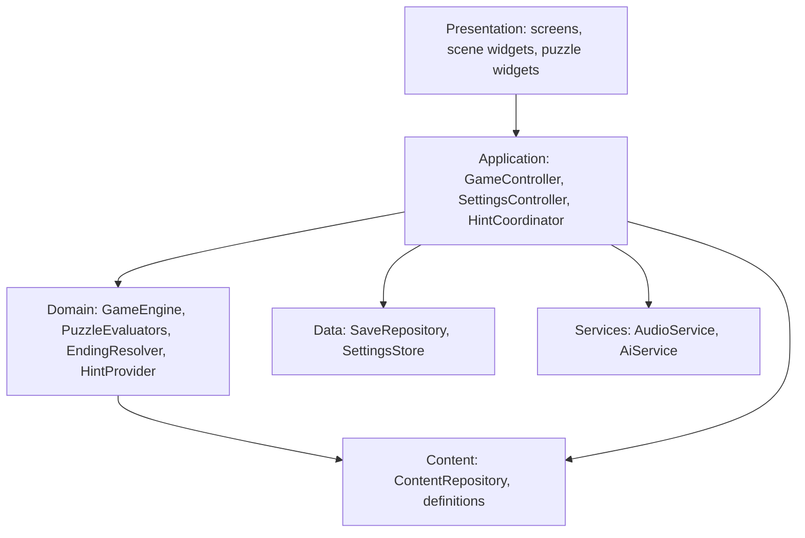
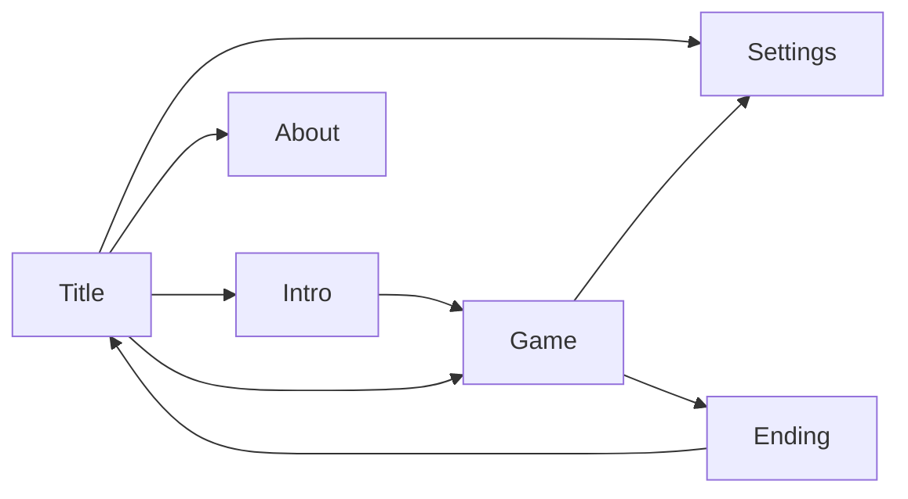
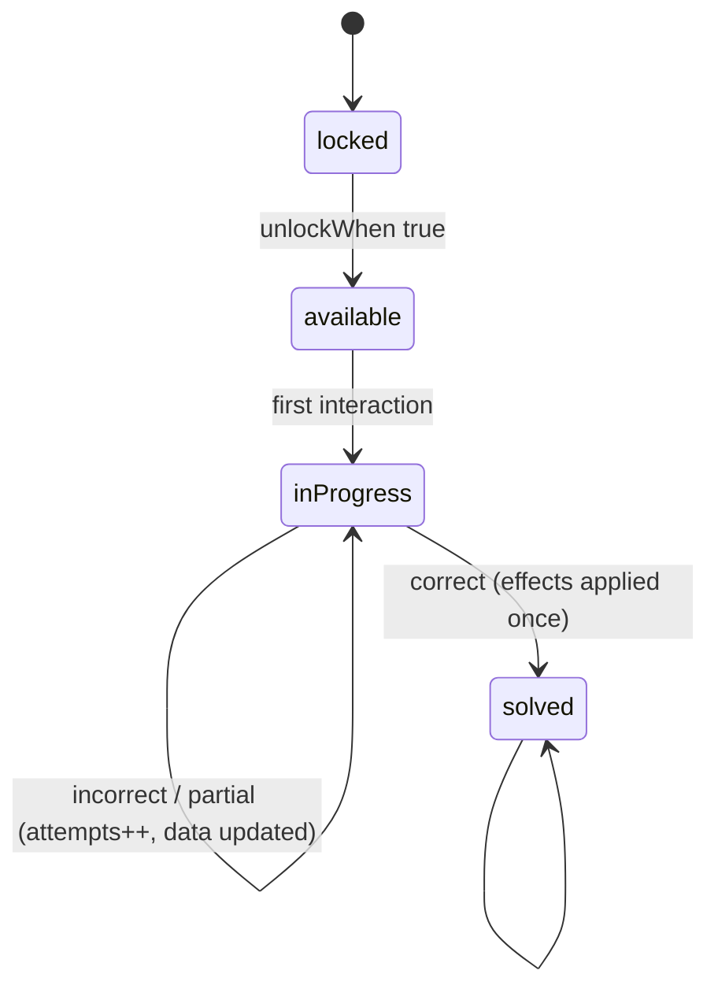

# Design Document

## Overview

HauntQuest AI is a data-driven point-and-tap adventure. All content (rooms, hotspots, items, puzzles, hints, choices, endings) is authored as JSON assets and loaded into immutable definitions. A **pure-Dart Game_Engine** applies named actions to an immutable `GameState` and returns the new state plus emitted events. Flutter widgets render state and dispatch actions. Persistence, audio, and the optional AI service sit behind small interfaces.

### Design Principles

1. **Core is offline and deterministic.** No randomness or clock input affects puzzle outcomes, hints, or endings.
2. **Engine is pure Dart.** It has no imports from `flutter`, so it is fast to unit test.
3. **Content is data, not code.** Solutions live in assets; widgets are generic puzzle renderers.
4. **AI is a decorator.** It can rewrite text, never state. Removing it changes nothing about gameplay.
5. **Minimal dependencies.** Prefer Flutter SDK features; add a package only when it removes real risk.
6. **One vertical slice architecture.** The slice uses the final architecture with a subset of content.

### Key Decisions and Rationale

| Decision | Choice | Rationale |
|----------|--------|-----------|
| State management | Engine in a `GameController extends ChangeNotifier`, exposed through `InheritedNotifier` (no package) | The game has one authoritative state object; fine-grained rebuilds come from `ValueListenable` selectors. Avoids a dependency and keeps the engine decoupled. |
| Navigation | `Navigator` 1.0 with a small `AppRoutes` map for menu screens; in-game rooms are **not** routes but a scene switched by `currentRoomId` | Rooms are state, not URLs. Avoids `go_router` and deep-link complexity. Back handling is explicit via `PopScope`. |
| Persistence | `shared_preferences` storing JSON strings (primary + backup keys) | One small, maintained, first-party-adjacent package that works on Android and Web. Saves are well under 100 KB. |
| Content format | JSON assets + hand-written `fromJson` | No code generation toolchain; schema validated at load. |
| Audio | `audioplayers` behind an `AudioService` interface, with a `NullAudioService` fallback | Simple API on Android and Web. Interface allows swapping or disabling. License must be confirmed (see licensing). |
| Visuals | Code-painted scenes (`CustomPainter`) and vector icons; no external image packs | Original by construction, tiny size, no license risk. Already established by the foundation `HauntedBackdrop`. |
| AI | `AiService` interface; HTTP implementation uses `dart:io`/`package:http` only if enabled | See AI section. |

---

## Architecture

### Layers



Dependency rule: arrows point inward. `domain` and `content` models never import `flutter`, `data`, or `services`.

### Directory Layout

```
lib/
  main.dart
  app/
    app.dart                  # MaterialApp, theme, routes
    app_routes.dart
    app_scope.dart            # InheritedNotifier wiring + service locator
  core/                       # (exists) theme, layout, shared widgets
    theme/ layout/ widgets/
    accessibility/            # semantics helpers, contrast utility
  domain/
    models/                   # GameState, PuzzleProgress, StoryFlags, enums
    engine/                   # GameEngine, actions, events
    puzzles/                  # PuzzleEvaluator + implementations
    story/                    # ChoiceResolver, EndingResolver
    hints/                    # HintProvider (authored), HintRequest
  content/
    definitions/              # RoomDef, HotspotDef, ItemDef, PuzzleDef, ChoiceDef, EndingDef
    content_repository.dart   # loads + validates assets
  data/
    save_repository.dart      # interface
    prefs_save_repository.dart
    save_migrator.dart
    settings_store.dart
  services/
    audio/ audio_service.dart, audioplayers_audio_service.dart, null_audio_service.dart
    ai/    ai_service.dart, ai_config.dart, http_ai_service.dart, ai_hint_enhancer.dart
  features/
    home/                     # (exists) title screen
    intro/
    game/                     # GameScreen, RoomScene, HotspotLayer, HUD, overlays
    inventory/
    puzzles/                  # one widget per puzzle type
    choices/
    hints/
    ending/
    settings/
    about/
assets/
  content/                    # rooms.json, items.json, puzzles.json, hints.json, story.json, endings.json
  audio/                      # only if licensed/created
docs/
  LICENSES_AND_ASSETS.md
test/ (mirrors lib/), integration_test/
```

### Component Responsibilities

| Component | Responsibility |
|-----------|----------------|
| `GameEngine` | Applies actions to `GameState` and returns `EngineResult(state, events)`. Contains all rules: movement, examine, use item, combine, puzzle submit, choice resolve, ending check. Pure and synchronous. |
| `PuzzleEvaluator` | Given `PuzzleDef`, `PuzzleProgress`, `PuzzleInput`, and read-only `GameState`, returns `PuzzleResult`. One implementation per puzzle kind. |
| `EndingResolver` | Maps `StoryFlags` to an `EndingId` using the ordered rules from `EndingDef`. |
| `HintProvider` (authored) | Selects hint target and tier from state, returns text. |
| `ContentRepository` | Loads JSON assets once, validates cross-references, exposes lookup maps. |
| `GameController` | Holds current `GameState` and `AppPhase`; runs engine actions; triggers autosave; publishes events stream to audio/UI feedback. |
| `SaveRepository` | Persist/load/delete `GameState`; atomic write, backup, migration. |
| `SettingsStore` | Persist `AppSettings` and `MetaProgress` (endings seen). |
| `AudioService` | Play music loop and one-shot SFX; apply volume/mute; pause on background. |
| `AiService` | `Future<String?> rewrite(AiRewriteRequest)`. Optional. |
| `HintCoordinator` | Combines authored hint with optional AI rewrite; guarantees authored hint is available first. |

---

## State Management

- `GameController` owns `ValueNotifier<GameState>` and `ValueNotifier<AppPhase>`. Widgets listen to narrow slices using `ValueListenableBuilder` with selector helpers (for example, `controller.select((s) => s.currentRoomId)`), keeping rebuilds local.
- `SettingsController extends ChangeNotifier` owns `AppSettings`; the `MaterialApp` listens to it for text scale, contrast, motion, and theme.
- Services are created in `main()` and exposed through `AppScope` (`InheritedWidget` holding a plain `AppServices` object) so tests can inject fakes.
- Events: `GameController.events` is a broadcast `Stream<GameEvent>`. Audio and toasts subscribe; the engine never calls services directly.
- The engine is the only code that mutates game rules. Widgets call `controller.dispatch(action)`.

### Application Phase Transition Table

| From | To (allowed) |
|------|--------------|
| `booting` | `titleMenu` |
| `titleMenu` | `intro`, `exploring` (continue) |
| `intro` | `exploring` |
| `exploring` | `puzzleActive`, `choiceActive`, `paused`, `ending`, `titleMenu` (exit) |
| `puzzleActive` | `exploring` |
| `choiceActive` | `exploring`, `ending` |
| `paused` | `exploring`, `titleMenu` |
| `ending` | `titleMenu`, `intro` (new adventure) |

Illegal transitions throw in debug (`assert`) and are ignored with a log in release.

---

## Data Models

All models are immutable, `==`/`hashCode` defined (hand-written or via `Equatable`-free value classes), and JSON round-trip tested.

### Runtime State

```dart
enum PuzzleStatus { locked, available, inProgress, solved }

class PuzzleProgress {
  final PuzzleStatus status;
  final int attempts;
  final int hintsUsed;           // highest tier shown, 0-3
  final Map<String, Object?> data; // puzzle-specific partial input (JSON primitives)
}

class StoryFlags {
  final Map<String, int> values;  // booleans stored as 0/1 for one uniform type
  // typed accessors: mercy, truthFragments, acceptedBargain, readDiary
}

class GameState {
  final int schemaVersion;
  final String currentRoomId;
  final Set<String> visitedRoomIds;
  final Set<String> openExitIds;
  final List<String> inventory;            // ordered item ids
  final Set<String> inspectedItemIds;
  final Set<String> consumedItemIds;
  final Map<String, PuzzleProgress> puzzleStates;
  final Set<String> examinedHotspotIds;
  final StoryFlags storyFlags;
  final Set<String> resolvedChoiceIds;
  final String? endingId;
  final int playTimeMs;
  final DateTime updatedAt;
}
```

### Settings and Meta (stored separately from the save)

```dart
class AppSettings {
  final double musicVolume, sfxVolume;   // 0.0 - 1.0
  final bool muted, reducedMotion, highContrast, highlightInteractables, spacedText;
  final double textScale;                // 1.0, 1.25, 1.5, 2.0
  final bool aiHintsEnabled, aiConsentGiven, tutorialSeen;
}
class MetaProgress { final Set<String> endingsSeen; }
```

### Content Definitions (loaded from assets, read-only)

```dart
class RoomDef { String id, name, description, ambientCue, sceneId; List<HotspotDef> hotspots; List<ExitDef> exits; }
class ExitDef { String id, toRoomId, label; Condition? unlockWhen; String lockedText; }
class HotspotDef {
  String id, label, semanticLabel; Rect2 area;      // normalized 0-1 coordinates
  Condition? requires; String lockedText;
  List<Effect> onExamine; String firstText, repeatText;
  List<UseRule> useRules;                           // item applied to hotspot
  String? puzzleId; String? choiceId;
}
class ItemDef { String id, name, description, detailText; String iconId; }
class UseRule { String itemId; Condition? when; List<Effect> effects; String successText; bool consumeItem; }
class CombineRule { List<String> itemIds; String resultItemId; String text; }
class PuzzleDef {
  String id, roomId, title, kind;                   // sequence | cipher | dial | combine | useItem | clock | gears
  Condition? unlockWhen; Map<String, Object?> config; // kind-specific, includes the solution
  List<Effect> onSolved; List<String> hints;       // exactly 3 tiers
  int hintPriority;
}
class ChoiceDef { String id, prompt; Condition? requires; List<ChoiceOption> options; }
class ChoiceOption { String id, label; Condition? enabledWhen; String disabledReason; List<Effect> effects; String resultText; }
class EndingDef { String id, title; List<String> epilogue; String sceneId, musicCue; }
class EndingRule { Condition when; String endingId; }  // ordered; last rule is the default
```

### Conditions and Effects (small declarative vocabulary)

```dart
sealed class Condition        // hasItem, puzzleSolved, flagAtLeast, flagEquals, exitOpen, examined, all, any, not
sealed class Effect           // giveItem, consumeItem, setFlag, addFlag, openExit, unlockPuzzle, markVisited, startChoice
```

Conditions are pure predicates over `GameState`. Effects are applied by the engine through one idempotent `applyEffect` function (for example `giveItem` is a no-op if the item is already held or consumed).

### Story Flags

| Flag | Type | Range | Meaning |
|------|------|-------|---------|
| `truthFragments` | int | 0–5 | Pieces of Ottoline's story: journal, wax cylinder, keeper's logbook, Maul's ledger, and asking Tallow |
| `mercy` | int | 0–3 | Kind choices: thank Tallow, answer the Echo gently, refuse Maul |
| `acceptedBargain` | bool | 0/1 | Player accepted Edric Maul's bargain |
| `fate` | int | 0–3 | Set by the final choice: 1 release, 2 call home, 3 claim |
| `cylinderPlayed`, `engineRestored` | bool | 0/1 | Progress markers that gate the tuner and the final choice |
| `tallowHurt`, `echoAngered`, `maulPressed` | bool | 0/1 | Tone flags that change later descriptions |

All flags are declared with their ranges in `assets/content/story.json`. The content model lives in `lib/content/` and the validator in `lib/content/validation/`.

### Domain Events

`RoomEntered`, `ItemAcquired`, `ItemConsumed`, `ItemInspected`, `HotspotExamined`, `ExitOpened`, `PuzzleUnlocked`, `PuzzleStarted`, `PuzzleAttempted(result)`, `PuzzleSolved`, `HintShown(tier)`, `ChoiceResolved`, `FlagChanged`, `EndingReached`, `ActionRejected(reason)`.

---

## Navigation and Scene Architecture

### App-Level Navigation



Menu screens are pushed routes. `GameScreen` is a single route that hosts all in-game UI.

### In-Game Scene Composition

`GameScreen` is a `Stack`:

1. `RoomScene` – `CustomPainter`-based scene chosen by `RoomDef.sceneId` (one painter per room, reusing the `HauntedBackdrop` approach and palette).
2. `HotspotLayer` – positioned, semantics-labeled tap targets built from normalized `HotspotDef.area`. Enforces a 48 dp minimum by expanding hit area while keeping the visual small. Optional highlight pulses (disabled by reduced motion).
3. `Hud` – room name, inventory button, hint button, map button, menu button. Anchored in safe area.
4. `OverlayHost` – one overlay at a time: text box, item inspect, inventory, puzzle panel, choice panel, hint sheet, map. Back gesture closes the top overlay first.

Room transitions use a short `FadeTransition` (reduced motion: instant swap). The scene widget is keyed by `currentRoomId`.

For accessibility, a "List view" mode renders the same Hotspots and Exits as a vertical list of buttons; it is automatically offered when a screen reader is detected and togglable in settings.

### Responsive Layout

- Compact: scene fills width; HUD at bottom.
- Medium/expanded: scene is constrained to a maximum aspect-correct size and centered; side panel hosts inventory and hints in landscape.
- Layout decisions use the existing `Responsive` helper and `LayoutBuilder`; never hard-coded device sizes.

---

## Persistence Strategy

### Storage

- `shared_preferences` keys: `save.auto.v1`, `save.auto.backup.v1`, `save.slot1..3.v1` (post-slice), `settings.v1`, `meta.v1`.
- Value is a JSON string `{"schemaVersion": N, ...}`; max expected size ≪ 100 KB.

### Write Protocol (atomic enough for key-value storage)

1. Serialize new state to JSON string and compute a checksum field.
2. Read current primary value; if valid, write it to the backup key.
3. Write the new value to primary.
4. On load: parse primary and verify checksum and validation (known ids). If invalid, parse backup. If both invalid, return `LoadResult.corrupt`.

An interruption between steps 2 and 3 leaves a valid backup; between 3 and completion leaves a valid primary. Each step is a single atomic key-value write.

### Autosave

`GameController` marks state dirty after each engine result that has events. A debounced writer (250 ms) coalesces bursts; `AppLifecycleListener` flushes on `paused`/`inactive`/`detached`. Writes run asynchronously and do not block frames.

### Migration

`SaveMigrator` holds an ordered list of `(fromVersion → toVersion)` pure functions on the JSON map. Loading applies migrations until `schemaVersion == current`. Unknown future versions are treated as unrecoverable-but-preserved (never deleted).

### Validation

`GameStateValidator.validate(state, content)` verifies all ids exist in `ContentRepository`, the inventory has no duplicates, a solved puzzle's effects are consistent, and flag ranges are in bounds.

---

## Puzzle Evaluation Logic

```dart
abstract interface class PuzzleEvaluator<I extends PuzzleInput> {
  PuzzleResult evaluate(PuzzleDef def, PuzzleProgress progress, I input, GameState state);
}
enum Verdict { correct, incorrect, partial }
class PuzzleResult { Verdict verdict; Map<String,Object?> newData; String feedbackKey; }
```

### Status Machine



`GameEngine.submitPuzzle` flow: reject if status ≠ available/inProgress → run evaluator → update `data`/`attempts` → if `correct`, set `solved` and apply `onSolved` effects through the idempotent effect applier → emit events.

### Evaluators

| Kind | Puzzles | Rule |
|------|---------|------|
| `useItem` | P1, P6 | Succeeds when the required item is applied to the hotspot and the precondition holds; otherwise deterministic failure text. |
| `sequence` | P2, P9 | Compare submitted ordered ids to the config sequence. `partial` when the prefix matches; `incorrect` resets progress to the matching prefix length of zero. |
| `cipher` | P3 | Normalize (trim, uppercase, strip spaces) and compare to the answer; hint metadata carries the shift. |
| `combine` | P4 | Correct when all three page items are placed in the slots in any order; riddle text is revealed. |
| `dial` | P5 | Integer value in a range must equal target; `partial` if within ±1 (a shown "almost" cue). |
| `clock` | P7 | Hour and minute equal the target derived from clues. |
| `gears` | P8 | Each gear has an orientation index; correct when the vector equals the target. Tap rotates the selected gear by one step. |

### Puzzle Dependency Chain (design intent)

Implemented in content; the generated map is `docs/PROGRESSION_GRAPH.md`.

- P1 (candle order, from Wren's letter) opens the library. P2 (brass key on Tallow) yields the lantern that every library hotspot needs.
- P3 (cipher, shift from the journal) opens the workshop passage and yields the left torn page. P4 combines both pages into the solvent.
- P6 (solvent on the cabinet) yields the wax cylinder. Playing it unlocks P5 (tuner), which yields the spare cog and opens the clocktower.
- P7 (clock, time from Wren's letter) yields the Resonance Core and unlocks the logbook and Maul's speaking tube. P8 (seat the cog, set gears from the journal) opens the vault.
- P9 needs the core and three clues: the recording ("water wakes first"), the journal ("after the water, the flame"), and the logbook ("wind always closes the circle"). `PuzzleDef.clues` declares each clue, and the validator checks that the text really appears in the source (Requirement 5.9).
- Exact values live in `assets/content/puzzles.json` and must not be duplicated in code.

### Content Validation

`ContentValidator` (pure Dart) checks unique ids, references, puzzle configs per kind, text limits, hint tiers, clue text, item supply, and single consumers for consumable items. `DependencyAnalyzer` finds missing or cyclic mandatory dependencies. `ProgressionSimulator` plays every dialogue-choice combination to prove rooms, items, hotspots, mandatory puzzles, and all endings are reachable with no dead ends. Tests in `test/content/` cover the real content and one corrupted variant per check.

### Hint Selection

```
target = highest hintPriority puzzle in currentRoom with status in {available, inProgress}
         else first unsolved puzzle in room order across rooms
         else ending guidance
tier   = min(3, progress.hintsUsed + 1)
if puzzle needs an item the player lacks → return item-acquisition hint for that item
```

Pure function of `GameState` and `ContentRepository`; repeated calls without state change increment `hintsUsed` only when the controller records the request.

---

## Story Branching Model

- Branching is **flag-based**, not a node graph: authored Choice_Events attach to hotspots or puzzle completions, apply effects, and mark `resolvedChoiceIds`.
- Four Choice_Events:
  1. **Tallow's Welcome** (`c_tallow_welcome`, Entrance Hall, after waking Tallow) – thank him (`mercy +1`), ask about Ottoline (`truthFragments +1`), or tell him to hurry (`tallowHurt`).
  2. **The Echo Whispers** (`c_echo_whisper`, Workshop speaking horn) – answer gently (`mercy +1`), demand it show itself (`echoAngered`), or stay silent.
  3. **Maul's Bargain** (`c_maul_bargain`, Clocktower speaking tube) – accept (`acceptedBargain`), refuse (`mercy +1`), or press him about the engine (`maulPressed`).
  4. **The Echo's Fate** (`c_echo_fate`, Echo Vault, final) – release, call Ottoline home, or claim the Echo. Gated as described under Ending Resolver; sets `fate`.
- `truthFragments` also increments the first time the player examines the journal desk, plays the wax cylinder, reads the keeper's logbook, or reads Maul's ledger. Four fragments are reachable without any dialogue choice, so The Homecoming never depends on a single optional answer.
- Text variants: `TextVariant { Condition when; String text }` lists let descriptions react to flags; first matching variant wins, last is the default.

### Ending Resolver

The final choice gates its options so endings are earned, and the ordered rules in `story.json` map `fate` to an ending:

| Option | Enabled when | Sets | Ending |
|--------|--------------|------|--------|
| Let the Echo rest | always | `fate = 1` | `quiet_dawn` (default rule) |
| Call Ottoline home | `truthFragments >= 4`, `mercy >= 2`, `acceptedBargain == 0` | `fate = 2` | `homecoming` |
| Claim the Echo | `acceptedBargain == 1` | `fate = 3` | `keepers_chair` |

Rules, in order: `fate == 3` → `keepers_chair`; `fate == 2` → `homecoming`; `always` → `quiet_dawn`. The last rule must be `always`, so the resolver is total. "Let the Echo rest" is never gated, which guarantees completion from every valid state.

Verified by `test/content/`: all 42 simulated choice combinations reach an ending (27 Quiet Dawn, 6 Homecoming, 9 Keeper's Chair), and the resolver is checked over the full flag cross product.

---

## UI Architecture

- **Theme**: reuse `AppTheme` and `AppColors`; add a `HighContrastTheme` variant (7:1) and `ThemeExtension` for game-specific tokens (glow colors, gold borders).
- **Shared widgets** (`core/widgets`): `GlowButton` (exists), `HauntedPanel` (parchment-on-navy dialog), `TypewriterText` (respects reduced motion, tap to complete), `ItemIcon` (CustomPainter icons), `ToastBanner`.
- **Puzzle widgets** are generic and driven by `PuzzleDef.config`: `SequencePuzzleView`, `CipherPuzzleView`, `DialPuzzleView`, `CombinePuzzleView`, `ClockPuzzleView`, `GearsPuzzleView`. All use tap-only controls (stepper buttons, not drag) and store partial input in `PuzzleProgress.data` so it survives rotation and restarts.
- **Feedback**: every verdict shows text plus icon; colors are supplemental.
- **Text scaling**: layouts use `Flexible`/`Wrap`/scroll containers; settings text scale is applied via `MediaQuery.copyWith(textScaler:)` at app root.
- **Reduced motion**: a single `MotionPolicy` inherited value that animated widgets consult; `HauntedBackdrop` already checks `disableAnimations` and will also read the app setting.
- **Back handling**: `PopScope` in `GameScreen` closes overlays first, then shows a pause menu.

---

## Optional AI Design

```dart
abstract interface class AiService {
  bool get isConfigured;
  Future<String?> rewrite(AiRewriteRequest request); // null on any failure
}
class AiRewriteRequest { String roomName; String authoredText; AiPurpose purpose; } // hint | flavor
```

- **Configuration**: endpoint and key supplied via `--dart-define=AI_ENDPOINT=...` / `AI_KEY=...` or entered by the user in Settings and stored in the settings store (never in saves or the repo). Because a key embedded in a client binary can be extracted, the recommended setup is a user-provided key or a proxy URL; no project backend is built.
- **Default wiring**: `NullAiService` (`isConfigured == false`). AI settings UI is hidden.
- **HintCoordinator flow**:
  1. Compute authored hint (synchronous) and show it immediately.
  2. If AI enabled and consented, start `rewrite` with a 4 s timeout.
  3. If a valid result arrives while the hint panel is still showing, swap text with a subtle fade; otherwise do nothing.
- **Validation** (`AiOutputValidator`): non-empty, ≤ 400 characters, no URL patterns, no markdown/HTML, and rejected if it contains the solution answer string of a puzzle whose requested tier is below tier 3 (prevents spoiler leakage).
- **Privacy**: only `roomName` and authored text up to the requested tier are sent. No state, no IDs.
- **Fallbacks** (all tested): not configured, not consented, offline, timeout, HTTP error, empty, invalid → authored text. Narrative flavor: a deterministic table of authored flavor lines indexed by `(roomId, flagsHash)`, or none.

---

## Error Handling

| Situation | Behavior |
|-----------|----------|
| Content asset missing or invalid | Fail fast at boot with a developer-readable error screen; covered by a unit test over all assets. |
| Illegal engine action | Engine returns `ActionRejected`; UI shows a neutral message or ignores. State unchanged. |
| Save corrupt | Backup fallback, then recoverable dialog; "New Adventure" always works. |
| Audio failure | `NullAudioService` fallback; logged once. |
| AI failure | Silent fallback to authored text. |
| Unknown future save version | Preserve data, offer new adventure. |

---

## Testing Strategy

| Level | Scope | Tooling |
|-------|-------|---------|
| Unit (domain) | Engine actions, effect idempotency, each puzzle evaluator (correct/incorrect/partial), phase table, ending resolver table test, hint selector, serializer round trip, migrator, validator | `flutter_test` |
| Content validation | Every JSON asset parses; all references resolve; every puzzle has exactly 3 hints; room graph connected with 5 rooms; ≥ 8 puzzles; each room ≥ 3 hotspots; every ending reachable by a scripted route | `flutter_test` |
| Property-style | Random action sequences (fixed seed) never violate state invariants (no duplicate inventory, solved never regresses) | `flutter_test` with seeded `Random` |
| Persistence | Fake in-memory prefs: round trip, corrupt primary → backup, interrupted write simulation, migration | `SharedPreferences.setMockInitialValues` |
| Widget | Title flows, hotspot tap + semantics + 48 dp, inventory at 200% text scale, each puzzle view, settings apply immediately, reduced motion, three widths (360, 700, 1100) | `flutter_test` |
| Integration | Scripted vertical-slice playthrough, later three full-ending playthroughs, offline run with throwing network client | `integration_test` |
| AI | Fake `AiService` for success/timeout/failure/invalid; assert no state mutation and fallback text | `flutter_test` |
| Performance | Profile-mode run with `traceAction` frame timing on a reference device; save duration test | manual + `integration_test` |
| Accessibility | Semantics tree assertions, contrast helper test on palette, TalkBack manual pass | `flutter_test`, manual |

Quality gates: `flutter analyze` and `flutter test` must pass at every checkpoint in `tasks.md`.

---

## Dependency and Asset Licensing Considerations

| Dependency | Purpose | When | Notes |
|------------|---------|------|-------|
| `flutter` SDK, `cupertino_icons`, `flutter_lints` | Base | Present | BSD-3 / MIT. |
| `shared_preferences` | Persistence | Slice | BSD-3, flutter.dev publisher. |
| `audioplayers` | Music and SFX | Slice or full | MIT; verify current version supports the installed Flutter/Dart and Web before adding; otherwise use `NullAudioService` and defer. |
| `http` | Optional AI HTTP | Full (optional) | BSD-3, dart.dev publisher; added only when the AI task starts. |
| `integration_test` (SDK) | Integration tests | Dev | SDK. |

Rules:

1. Before adding any package, check pub.dev for version compatibility with Dart 3.13 / Flutter 3.47, publisher verification, recent releases, and license; pin versions in `pubspec.yaml` (caret on exact tested version) and record them in `docs/LICENSES_AND_ASSETS.md`.
2. Do not add packages for navigation, state management, serialization, or fonts.
3. Fonts: use system serif stack (already configured). If a custom font is later added it must be OFL/Apache licensed and bundled, never downloaded at runtime.
4. Art: all scene art and icons are procedurally painted by project code (original). No stock or AI-generated imagery is bundled unless its license is verified and recorded.
5. Audio: prefer original synthesized loops/SFX generated by a script committed in `tools/`, or CC0 sources with provenance documented. CC-BY assets need on-screen credits.
6. Story text: written for this project; no references to third-party characters or settings.
7. A test script verifies that each dependency and each file under `assets/` appears in `docs/LICENSES_AND_ASSETS.md`.
8. `.kiro/` remains tracked in version control as evidence of spec-driven development.
