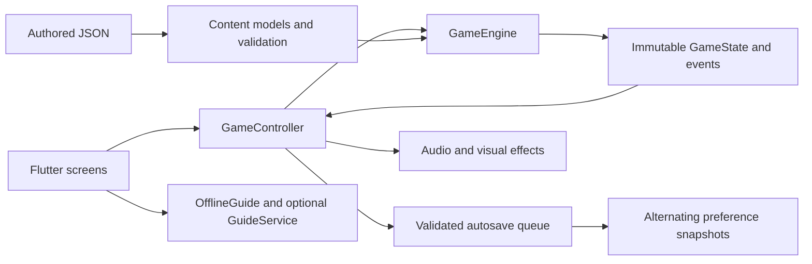

# Architecture

HauntQuest AI is a Flutter client with an offline, deterministic pure-Dart core.
The package name is `hauntquest`; the intended repository name is `hauntquest-ai`.
No server is needed for gameplay, saves or hints.

## Boundaries and data flow

- `lib/content/`: typed definitions, reference checks, dependency analysis,
  progression simulation and narrative graph validation. Data lives in five JSON
  files under `assets/content/`. Duplicate IDs, unknown references, missing clue
  sources, invalid puzzle configurations and dialogue continuation cycles fail checks.
- `lib/domain/engine/game_engine.dart`: authoritative legal moves, examination,
  item use, rewards, consumption, puzzle submissions and choice resolution.
  Rejected actions leave progression unchanged (wrong answers record attempts).
  UI, sound and companion code cannot grant items or set win conditions.
- `lib/domain/models/game_state.dart`: immutable snapshots and explicit save schema.
  Puzzle drafts, hints, attempts and solved IDs are separate; reopening a solved
  apparatus cannot repeat its rewards.
- `lib/domain/puzzles/`: deterministic evaluators. Fixed data configurations avoid
  impossible random generation. Tests enumerate solutions where useful.
- `lib/domain/narrative/`: evaluates choices, flag-dependent reactions, transcripts,
  journal discoveries, evidence links and ending requirements. Dialogue nodes share
  IDs and resolve once; revisits display recorded exchanges.
- `lib/app/game_controller.dart`: observable presentation adapter. Runs engine
  actions, exposes feedback/events and queues immutable snapshots in order.
- `lib/features/`: room, inventory, puzzle, dialogue, guide, journal, menu, ending
  and settings presentation. `lib/core/` holds design tokens, painters, motion policy
  and shared controls. Flutter SDK notifiers handle state; no code generation or
  external state-management framework is required.

## Persistence and recovery

`SaveCodec` validates schema, complete field sets, content IDs, item ownership,
consumption/reward integrity, room connectivity and final-choice/ending agreement.
It migrates supported version 1 data to current **version 2**. Invalid snapshots
never partially populate the live game. A future version is preserved and blocks
ordinary overwrite until the player explicitly confirms New Game.

`PrefsGameStore` writes through `AtomicPreferences`: write the inactive slot,
verify the full serialized envelope/checksum, then switch a commit pointer. The
previous valid slot is retained. Recovery tries valid committed/backup candidates;
legacy bytes remain until a deliberate reset. Queues serialize saves and reset
so an old queued action cannot overwrite a new journey. Errors preserve live
progress, show a retry option and keep the prior completed save when possible.
Settings use their own versioned alternating slots and queue. Local preference
storage cannot guarantee recovery if the device destroys all copies.

## Sound, rendering and lifecycle

`AudioDirector` reads game events and settings; it never mutates authoritative
state. `LocalAudioBackend` uses one native ambient player and a bounded pool of
three effect voices. All 20 PCM files are locally bundled and procedurally generated
at development time. There is no runtime synthesis or position polling. Mute and
master/ambient/effects gains apply immediately and persist.

The root lifecycle listener stops audio and disables gameplay tickers in background,
flushes pending writes, and resumes ambient sound in foreground. Controllers,
observers, timers and players are disposed. Finite feedback bursts are isolated
with repaint boundaries; room background art is cached separately from moving
foreground fog. `MotionPolicy` combines app and OS reduced-motion settings.
Ending reveals are skippable and distinct for each ending.

## Whispering Guide and privacy

`OfflineGuide` builds an immutable allowlist of discovered evidence and contextual
hint passages for the selected tier. `GuideService` accepts only IDs from that
allowlist. The shipped game has **no remote provider**, networking SDK, API key,
analytics, login or telemetry. Optional provider support is an interface, not a
claim of live AI. A future adapter requires explicit consent and a backend proxy
for secrets; requests must stay minimal. Failures/timeouts/invalid output retain
offline passages. No companion result is treated as an engine command.

## Tests and release configuration

- Domain/content tests: legal journeys, all endings, graph integrity, positive and
  negative puzzle validation, exhaustive/seeded constraints and duplicate rewards.
- Persistence tests: round trips, migrations, torn writes, damaged checksums,
  invalid state, protected future versions and serialized New Game behavior.
- UI tests: complete controls, restart flows, ending decisions, responsive/enlarged
  layouts, semantics, settings, lifecycle, reduced motion and nonfatal audio failure.
- Native integration tests: full five-room player-input journey and platform save
  reload. The reload test is in-process; cold restart needs the manual checklist.
- Release build: `lib/main.dart`, version `1.0.0+1`, Android ID
  `io.github.myproject48.hauntquest`, minimum API 24. Review controls are excluded
  by default in release. Never enable `HQ_REVIEW_TOOLS` for the judging APK.
- Android signing: optional ignored `android/key.properties`; otherwise the
  evaluation APK uses the development certificate. No release secret is committed.

See [RELEASE_VALIDATION.md](RELEASE_VALIDATION.md) for measured checks and limits.
