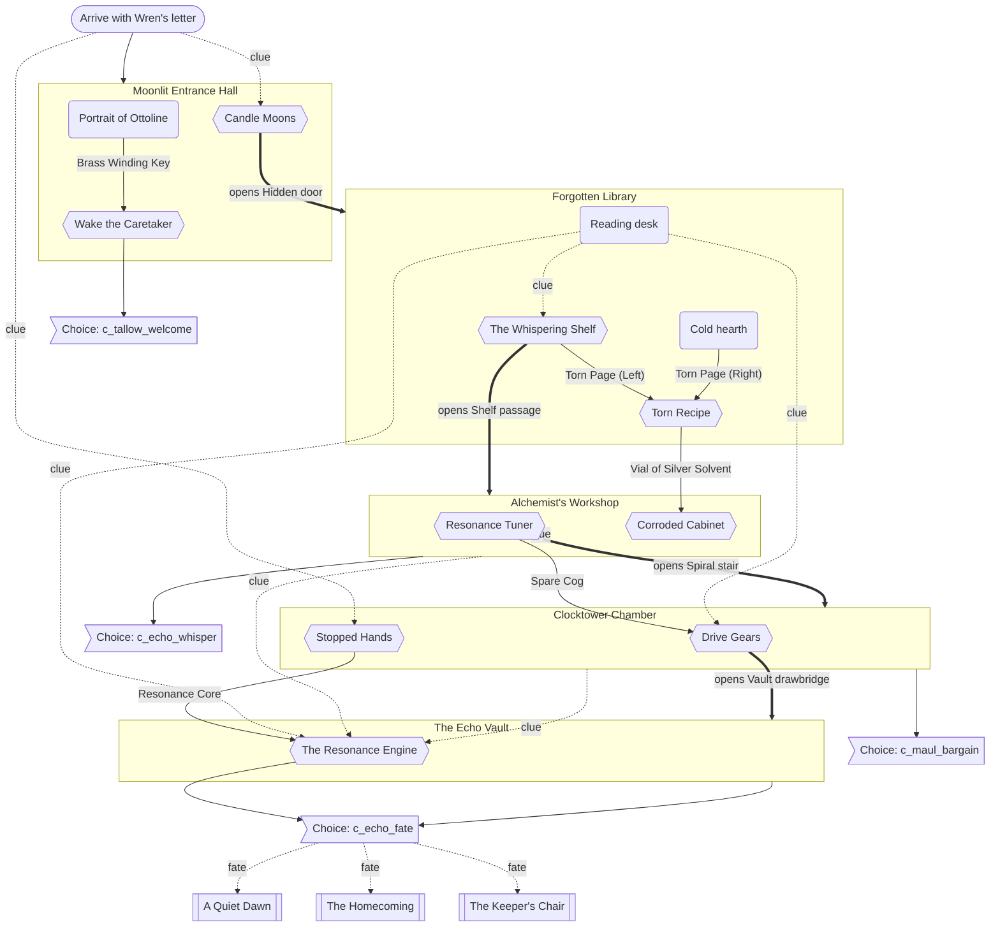

# Progression Graph: The Whispering Manor

Generated by `dart run tool/generate_progression_graph.dart`. Do not edit by hand.

Solid arrows are required items or openings. Dashed arrows are clues the player must read. Thick arrows open a passage.

## Puzzle prerequisites

| Puzzle | Room | Needs items | Needs clues from |
|---|---|---|---|
| Candle Moons | Moonlit Entrance Hall | - | item:wrens_letter |
| Wake the Caretaker | Moonlit Entrance Hall | Brass Winding Key | - |
| The Whispering Shelf | Forgotten Library | - | item:ottoline_journal |
| Torn Recipe | Forgotten Library | Torn Page (Left), Torn Page (Right) | - |
| Resonance Tuner | Alchemist's Workshop | - | hotspot:w_phonograph |
| Corroded Cabinet | Alchemist's Workshop | Vial of Silver Solvent | - |
| Stopped Hands | Clocktower Chamber | - | item:wrens_letter |
| Drive Gears | Clocktower Chamber | Spare Cog | item:ottoline_journal |
| The Resonance Engine | The Echo Vault | Resonance Core | hotspot:w_phonograph, item:ottoline_journal, hotspot:c_logbook |

## Mandatory solve order (one valid order)

1. Candle Moons (`p1_candle_moons`)
2. Wake the Caretaker (`p2_wake_tallow`)
3. The Whispering Shelf (`p3_shelf_cipher`)
4. Torn Recipe (`p4_torn_pages`)
5. Corroded Cabinet (`p6_corroded_cabinet`)
6. Resonance Tuner (`p5_resonance_tuner`)
7. Stopped Hands (`p7_stopped_hands`)
8. Drive Gears (`p8_gear_alignment`)
9. The Resonance Engine (`p9_resonance_engine`)

## Endings

| Ending | Example choices | Choice combinations |
|---|---|---|
| A Quiet Dawn | tw_kind, ew_gentle, mb_accept, ef_release | 27 |
| The Homecoming | tw_kind, ew_gentle, mb_refuse, ef_home | 6 |
| The Keeper's Chair | tw_kind, ew_gentle, mb_accept, ef_claim | 9 |

Validation: 0 errors, 0 warnings, 42 choice combinations simulated.
