# Progression Graph: The Whispering Manor

Generated by `dart run tool/generate_progression_graph.dart`. Do not edit by hand.

Solid arrows are required items or openings. Dashed arrows are clues the player must read. Thick arrows open a passage.

```mermaid
flowchart TD
  subgraph room_moonlit_hall["Moonlit Entrance Hall"]
    hs_h_portrait("Portrait of Ottoline")
    pz_p1_candle_moons{{"Candle Moons"}}
    pz_p2_wake_tallow{{"Wake the Caretaker"}}
    pz_p10_symbol_seal{{"The Symbol Seal"}}
    pz_p14_mirror{{"The Silver Mirror"}}
  end
  subgraph room_forgotten_library["Forgotten Library"]
    hs_l_desk("Reading desk")
    hs_l_hearth("Cold hearth")
    pz_p3_shelf_cipher{{"The Whispering Shelf"}}
    pz_p4_torn_pages{{"Torn Recipe"}}
    pz_p12_rune_gaps{{"The Missing Runes"}}
    pz_p15_evidence{{"The Evidence Board"}}
  end
  subgraph room_alchemist_workshop["Alchemist's Workshop"]
    pz_p5_resonance_tuner{{"Resonance Tuner"}}
    pz_p6_corroded_cabinet{{"Corroded Cabinet"}}
    pz_p13_alchemy{{"Moonwater Alchemy"}}
  end
  subgraph room_clocktower_chamber["Clocktower Chamber"]
    pz_p7_stopped_hands{{"Stopped Hands"}}
    pz_p8_gear_alignment{{"Drive Gears"}}
    pz_p11_constellation{{"Constellation Discs"}}
  end
  subgraph room_echo_vault["The Echo Vault"]
    pz_p9_resonance_engine{{"The Resonance Engine"}}
    pz_p16_echo_frequencies{{"The Echo Frequencies"}}
  end
  start(["Arrive with Wren's letter"])
  start --> room_moonlit_hall
  end_release_echo[["Release the Echo"]]
  end_echo_guardian[["Become the Echo's Guardian"]]
  end_seal_echo[["Seal the Echo"]]
  ch_c_tallow_welcome>"Choice: c_tallow_welcome"]
  ch_c_echo_whisper>"Choice: c_echo_whisper"]
  ch_c_maul_bargain>"Choice: c_maul_bargain"]
  ch_c_echo_fate>"Choice: c_echo_fate"]
  ch_c_tallow_memory>"Choice: c_tallow_memory"]
  ch_c_echo_identity>"Choice: c_echo_identity"]
  ch_c_maul_terms>"Choice: c_maul_terms"]
  start -.->|"clue"| pz_p1_candle_moons
  hs_h_portrait -->|"Brass Winding Key"| pz_p2_wake_tallow
  hs_l_desk -.->|"clue"| pz_p3_shelf_cipher
  pz_p3_shelf_cipher -->|"Torn Page (Left)"| pz_p4_torn_pages
  hs_l_hearth -->|"Torn Page (Right)"| pz_p4_torn_pages
  room_alchemist_workshop -.->|"clue"| pz_p5_resonance_tuner
  pz_p4_torn_pages -->|"Vial of Silver Solvent"| pz_p6_corroded_cabinet
  start -.->|"clue"| pz_p7_stopped_hands
  pz_p5_resonance_tuner -->|"Spare Cog"| pz_p8_gear_alignment
  hs_l_desk -.->|"clue"| pz_p8_gear_alignment
  pz_p7_stopped_hands -->|"Resonance Core"| pz_p9_resonance_engine
  room_alchemist_workshop -.->|"clue"| pz_p9_resonance_engine
  hs_l_desk -.->|"clue"| pz_p9_resonance_engine
  room_clocktower_chamber -.->|"clue"| pz_p9_resonance_engine
  start -->|"Wren's Letter"| pz_p10_symbol_seal
  room_moonlit_hall -.->|"clue"| pz_p10_symbol_seal
  hs_l_desk -->|"Ottoline's Journal"| pz_p11_constellation
  room_clocktower_chamber -.->|"clue"| pz_p11_constellation
  hs_l_desk -->|"Ottoline's Journal"| pz_p12_rune_gaps
  room_forgotten_library -.->|"clue"| pz_p12_rune_gaps
  hs_l_desk -->|"Ottoline's Journal"| pz_p13_alchemy
  room_alchemist_workshop -.->|"clue"| pz_p13_alchemy
  pz_p2_wake_tallow -->|"Tallow's Lantern"| pz_p14_mirror
  room_moonlit_hall -.->|"clue"| pz_p14_mirror
  hs_l_desk -->|"Ottoline's Journal"| pz_p15_evidence
  room_forgotten_library -.->|"clue"| pz_p15_evidence
  hs_l_desk -->|"Ottoline's Journal"| pz_p16_echo_frequencies
  room_echo_vault -.->|"clue"| pz_p16_echo_frequencies
  pz_p1_candle_moons ==>|"opens Hidden door"| room_forgotten_library
  pz_p2_wake_tallow --> ch_c_tallow_welcome
  pz_p3_shelf_cipher ==>|"opens Shelf passage"| room_alchemist_workshop
  pz_p5_resonance_tuner ==>|"opens Spiral stair"| room_clocktower_chamber
  pz_p8_gear_alignment ==>|"opens Vault drawbridge"| room_echo_vault
  pz_p9_resonance_engine --> ch_c_echo_fate
  room_alchemist_workshop --> ch_c_echo_whisper
  room_clocktower_chamber --> ch_c_maul_bargain
  room_echo_vault --> ch_c_echo_fate
  ch_c_tallow_welcome -->|"Thank him warmly."| ch_c_tallow_memory
  ch_c_tallow_welcome -->|"Ask what happened to Ottoline."| ch_c_tallow_memory
  ch_c_tallow_welcome -->|"Tell him to hurry."| ch_c_tallow_memory
  ch_c_echo_whisper -->|"'A friend. I'm listening.'"| ch_c_echo_identity
  ch_c_echo_whisper -->|"'Show yourself.'"| ch_c_echo_identity
  ch_c_echo_whisper -->|"Say nothing."| ch_c_echo_identity
  ch_c_maul_bargain -->|"Accept his bargain."| ch_c_maul_terms
  ch_c_maul_bargain -->|"Refuse."| ch_c_maul_terms
  ch_c_maul_bargain -->|"Ask what he did to the engine."| ch_c_maul_terms
  ch_c_echo_fate -.->|"fate"| end_release_echo
  ch_c_echo_fate -.->|"fate"| end_echo_guardian
  ch_c_echo_fate -.->|"fate"| end_seal_echo
```

## Puzzle prerequisites

| Puzzle | Room | Needs items | Needs clues from |
|---|---|---|---|
| Candle Moons | Moonlit Entrance Hall | - | item:wrens_letter |
| Wake the Caretaker | Moonlit Entrance Hall | Brass Winding Key | - |
| The Whispering Shelf | Forgotten Library | - | item:ottoline_journal |
| Torn Recipe | Forgotten Library | Torn Page (Left), Torn Page (Right) | - |
| Resonance Tuner | Alchemist's Workshop | - | hotspot:w_phonograph |
| Corroded Cabinet | Alchemist's Workshop | Vial of Silver Solvent | - |
| Stopped Hands | Clocktower Chamber | - | item:wrens_letter |
| Drive Gears | Clocktower Chamber | Spare Cog | item:ottoline_journal |
| The Resonance Engine | The Echo Vault | Resonance Core | hotspot:w_phonograph, item:ottoline_journal, hotspot:c_logbook |
| The Symbol Seal | Moonlit Entrance Hall | Wren's Letter | hotspot:q10_symbol_seal |
| Constellation Discs | Clocktower Chamber | Ottoline's Journal | hotspot:q11_constellation |
| The Missing Runes | Forgotten Library | Ottoline's Journal | hotspot:q12_rune_gaps |
| Moonwater Alchemy | Alchemist's Workshop | Ottoline's Journal | hotspot:q13_alchemy |
| The Silver Mirror | Moonlit Entrance Hall | Tallow's Lantern | hotspot:q14_mirror |
| The Evidence Board | Forgotten Library | Ottoline's Journal | hotspot:q15_evidence |
| The Echo Frequencies | The Echo Vault | Ottoline's Journal | hotspot:q16_echo_frequencies |

## Mandatory solve order (one valid order)

1. Candle Moons (`p1_candle_moons`)
2. Wake the Caretaker (`p2_wake_tallow`)
3. The Symbol Seal (`p10_symbol_seal`)
4. The Silver Mirror (`p14_mirror`)
5. The Whispering Shelf (`p3_shelf_cipher`)
6. Torn Recipe (`p4_torn_pages`)
7. The Missing Runes (`p12_rune_gaps`)
8. The Evidence Board (`p15_evidence`)
9. Corroded Cabinet (`p6_corroded_cabinet`)
10. Moonwater Alchemy (`p13_alchemy`)
11. Resonance Tuner (`p5_resonance_tuner`)
12. Stopped Hands (`p7_stopped_hands`)
13. Drive Gears (`p8_gear_alignment`)
14. Constellation Discs (`p11_constellation`)
15. The Resonance Engine (`p9_resonance_engine`)
16. The Echo Frequencies (`p16_echo_frequencies`)

## Endings

| Ending | Example choices | Choice combinations |
|---|---|---|
| Release the Echo | tw_kind, tm_listen, ew_gentle, ei_person, mb_accept, mt_learn, ef_release | 180 |
| Become the Echo's Guardian | tw_kind, tm_listen, ew_gentle, ei_person, mb_accept, mt_break, ef_guardian | 16 |
| Seal the Echo | tw_kind, tm_listen, ew_gentle, ei_person, mb_accept, mt_learn, ef_seal | 180 |

Validation: 0 errors, 0 warnings, 376 choice combinations simulated.
